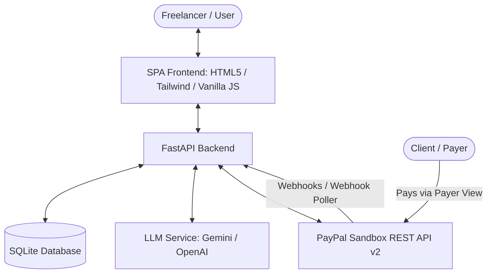

# DueNow

AI-powered Invoicing & Cashflow Intelligence for Freelancers and Independent Contractors.

---

## Overview

DueNow is an automated invoicing and collections assistant built for freelancers, consultants, and solo service providers who struggle with delayed client payments. Instead of spending hours chasing unpaid bills or awkward manual follow-ups, DueNow turns messy work notes into structured PayPal invoices, forecasts expected payment dates based on client payment history, and drafts tone-appropriate payment reminders. By integrating natively with the PayPal Invoicing API, DueNow ensures independent professionals spend less time on administrative receivables and get paid reliably on time.

---

## Features

- **Smart Invoice Generation**: Converts unstructured notes, chat summaries, or bullet points into formal invoices with line items, due dates, and totals.
- **Client Reliability Scoring**: Tracks past payment timeliness per client (0–100 score) to calculate behavioral risk and predict actual payment arrival dates.
- **Cashflow Forecasting**: Analyzes open receivables against predicted collection dates to project cash liquidity over 30, 60, and 90-day horizons.
- **Tone-Adaptive Follow-up Queue**: Autonomously drafts polite, firm, or urgent reminders based on client score and days overdue, with full merchant review.
- **PayPal Sandbox Sync**: Generates real draft invoices, sends official PayPal notifications, and syncs payment statuses automatically via webhooks and background polling.
- **Time Simulation Controls**: Test future invoice states with simulated fast-forward (+7d, +14d, +30d) without altering system clocks.

---

## How PayPal Is Used

DueNow communicates directly with the **PayPal Invoicing API v2** and **Notifications API v1** in PayPal Sandbox:

### Endpoints Called
- `POST /v1/oauth2/token` — Exchanges client ID and secret for a scoped Bearer token.
- `POST /v2/invoicing/generate-next-invoice-number` — Obtains the next sequential invoice ID from PayPal.
- `POST /v2/invoicing/invoices` — Creates draft invoices with line items, currency, terms, and tax.
- `POST /v2/invoicing/invoices/{invoice_id}/send` — Dispatches invoice notification and payer view URL to client email.
- `GET /v2/invoicing/invoices/{invoice_id}` — Retrieves current invoice status and payment metadata for background sync.
- `POST /v2/invoicing/invoices/{invoice_id}/remind` — Sends PayPal-delivered email reminders to clients.
- `POST /v2/invoicing/invoices/{invoice_id}/cancel` — Cancels unpaid invoices in PayPal with an audit reason.
- `POST /v2/invoicing/invoices/{invoice_id}/payments` — Records external or manual payments against invoices.
- `POST /v1/notifications/verify-webhook-signature` — Validates cryptographic signature headers of incoming events.

### Webhook Events Handled
- `INVOICING.INVOICE.PAID` — Marks invoice paid, updates client reliability score, and recalculates cashflow forecasts.
- `INVOICING.INVOICE.CANCELLED` — Updates local status to cancelled and cancels active reminders.
- `INVOICING.INVOICE.REFUNDED` — Updates local status to refunded.

---

## How AI Is Used

DueNow integrates with **Google Gemini** (`gemini-3.5-flash-`, with automatic fallback to other Gemini Flash models):

1. **Invoice Extraction**: Translates raw text (e.g., "designed 3 landing pages for Acme at 200 each, net 15") into structured line items, quantities, rates, and due dates.
2. **Reminder Drafting**: Generates context-aware follow-up messages tailored to client score (friendly for reliable payers, firm for persistent delays).
3. **Cashflow Insights**: Analyzes overall receivable distribution to generate concise, human-readable commentary on liquidity risk.

**Validation & Safety**: Every LLM response is strictly parsed and validated against structured Pydantic schemas before reaching the UI or PayPal. If an extraction is ambiguous, the system prompts the user for clarification rather than inventing invoice details.

---

## Architecture



- **Backend**: FastAPI (Python 3.13), SQLAlchemy, Pydantic, HTTPX.
- **Database**: SQLite (local development / demo).
- **Frontend**: Lightweight SPA (HTML5, Tailwind CSS, Vanilla JavaScript, Heroicons).
- **External Services**: PayPal REST API (Invoicing v2, Notifications), Google Gemini / OpenAI.

---

## Demo Data

- The seeded clients and historical invoices provided at startup are demonstration data intended to showcase reliability scores, approval queues, and cashflow charts immediately upon first launch.
- The **Fast-forward** button advances simulated time locally to test overdue transitions without waiting.
- Creating an invoice, clicking **Send**, triggering a reminder, and checking payment statuses all invoke real PayPal Sandbox API endpoints when PayPal credentials are configured.

---

## Setup and Run Locally

### Prerequisites
- Python 3.13 (tested on Python 3.13.3)
- PayPal Developer account (sandbox REST app credentials)
- Gemini API key (or OpenAI API key)

### Installation
1. Clone the repository and navigate into the root directory:
   ```bash
   git clone https://github.com/kaush15/duenow.git
   cd duenow
   ```
2. Create and activate a virtual environment:
   ```bash
   python -m venv venv
   # On Windows:
   venv\Scripts\activate
   # On macOS/Linux:
   source venv/bin/activate
   ```
3. Install dependencies:
   ```bash
   pip install -r requirements.txt
   ```
4. Copy `.env.example` to `.env`:
   ```bash
   cp .env.example .env
   ```
5. Configure credentials in `.env`:
   - Obtain `PAYPAL_CLIENT_ID` and `PAYPAL_CLIENT_SECRET` from [PayPal Developer Dashboard](https://developer.paypal.com/dashboard/applications/sandbox).
   - Set `PAYPAL_BUSINESS_EMAIL` to your sandbox merchant account email.
   - Obtain `LLM_API_KEY` from Google AI Studio or OpenAI.
6. Start the development server:
   ```bash
   uvicorn backend.main:app --host 0.0.0.0 --port 8000 --reload
   ```
7. Open [http://localhost:8000](http://localhost:8000) in your web browser.

---

## Testing

### Automated Unit Tests
Run the test suite with pytest:
```bash
pytest
```

### Manual End-to-End Test Flow
1. Navigate to **New Invoice** and enter notes (e.g. `Consulting with Acme Corp: 5 hours at $100/hr, due in 14 days`).
2. Click **Generate Draft with AI**, review extracted items, and click **Create & Send via PayPal**.
3. In the Invoices table, click **View** to open the real PayPal Sandbox Payer View URL.
4. Log in with a sandbox buyer personal account (*Provided in the Devpost testing instructions*) and complete the checkout payment.
5. Return to DueNow; within 30 seconds (or via webhook), the invoice status automatically updates to **PAID**.
6. For open invoices, click **Remind** to draft and dispatch a personalized reminder via PayPal.

---

## Deploy to Render

1. Create a new **Web Service** on [Render](https://render.com) connected to your GitHub repository.
2. Select the repository root; Render detects `render.yaml` automatically.
3. In the Render service settings, ensure:
   - **Build Command**: `pip install -r requirements.txt`
   - **Start Command**: `uvicorn backend.main:app --host 0.0.0.0 --port $PORT`
   - **Health Check Path**: `/api/health`
4. Fill in environment variables in the Render dashboard:
   - `PAYPAL_CLIENT_ID`, `PAYPAL_CLIENT_SECRET`, `PAYPAL_BUSINESS_EMAIL`
   - `LLM_API_KEY`, `APP_BASE_URL` (set to your Render service URL, e.g., `https://duenow.onrender.com`)

---

## Webhook Setup

1. In the [PayPal Developer Dashboard](https://developer.paypal.com/dashboard/applications/sandbox), select your REST app.
2. Click **Add Webhook**.
3. Set Webhook URL to: `https://<your-render-url>/webhooks/paypal`
4. Select the following event types:
   - `Invoicing invoice paid` (`INVOICING.INVOICE.PAID`)
   - `Invoicing invoice cancelled` (`INVOICING.INVOICE.CANCELLED`)
   - `Invoicing invoice refunded` (`INVOICING.INVOICE.REFUNDED`)
5. Save the webhook, copy the generated **Webhook ID**, and set `PAYPAL_WEBHOOK_ID` in your `.env` or Render environment settings.

### Webhook Verification & Security Notes
- **Strict Signature Verification**: By default, incoming webhook events are cryptographically verified against PayPal's public certificates. If signature headers are missing, the webhook ID is unset, or verification fails, the request is rejected with HTTP 400 and logged to `audit_logs` (`WEBHOOK_REJECTED`).
- **PAYPAL_WEBHOOK_ID Required**: `PAYPAL_WEBHOOK_ID` must be configured after creating the webhook so that signatures can be verified against your specific webhook instance.
- **Automatic Fallback Polling**: If webhooks are not yet registered or configured, DueNow's built-in 30-second background polling task automatically synchronizes invoice statuses from PayPal Sandbox.
- **Local Testing (`ALLOW_UNSIGNED_WEBHOOKS`)**: For local testing without public tunneling, set `ALLOW_UNSIGNED_WEBHOOKS=true` in your local `.env`. When active, unsigned webhooks are permitted and a prominent security warning is logged on each request. **Never enable this flag in production.**

---

## Pushing to GitHub safely

To ensure secrets and private credentials are never accidentally exposed:
1. Initialize git and check tracked files:
   ```bash
   git init
   git add .
   git status
   ```
2. Confirm that `.env` and `Basic Details.txt` are **not** listed in the untracked or staged files (both are protected by `.gitignore`).
3. Commit and push via the command line:
   ```bash
   git commit -m "Initial commit"
   git branch -M main
   git remote add origin <your-github-repo-url>
   git push -u origin main
   ```
> [!IMPORTANT]
> Avoid uploading files via the GitHub web browser drag-and-drop interface, as the web uploader ignores `.gitignore` rules and can inadvertently publish confidential configuration files.

---

## Known Limitations

- **Sandbox Only**: Configured for PayPal Sandbox testing and demonstrations; production deployment requires standard PayPal business account onboarding and verification.
- **Ephemeral Storage on Render Free Tier**: SQLite is stored locally on the instance disk. Database changes reset across service redeployments unless persistent disk storage is configured.
- **LLM Rate Limits**: Free-tier Gemini or OpenAI keys may encounter occasional per-minute rate limits during high concurrent usage.

---

## License

This project is licensed under the MIT License. See [LICENSE](LICENSE) for details.
